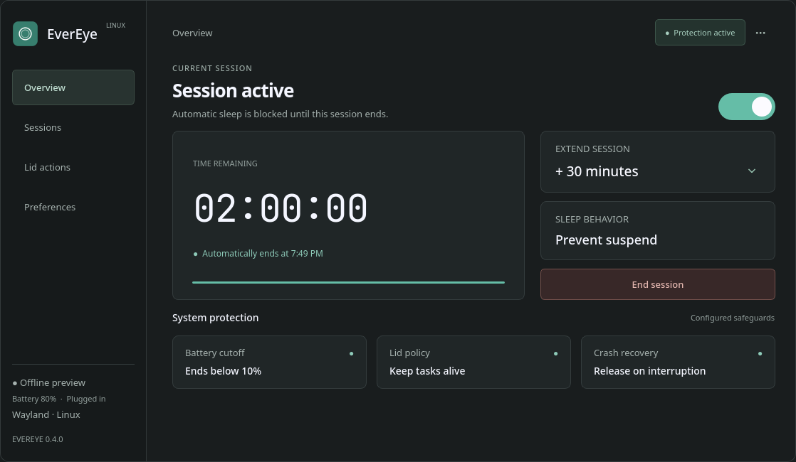

# EverEye for Linux

EverEye is a native Qt desktop utility for keeping a Linux workstation awake during bounded work sessions. Set a deadline for a build, download, QEMU VM, render, or AI agent, then step away. The session controller uses Linux power services, releases its inhibitors on expiry or interruption, and keeps your normal power policy in charge outside the session.

**Website:** [evereye-linux.vercel.app](https://evereye-linux.vercel.app/)  
**Latest release:** [EverEye 0.4.0](https://github.com/Prof-bilal/evereye-linux/releases/tag/v0.4.0)  
**License:** MIT



## Install the desktop app

For a tested x86_64 Linux desktop, download `evereye-0.4.0-linux-x86_64.tar.gz` from the [release page](https://github.com/Prof-bilal/evereye-linux/releases/tag/v0.4.0), extract it, and run the installer once:

```bash
tar -xzf evereye-0.4.0-linux-x86_64.tar.gz
cd evereye-0.4.0-linux-x86_64
./install-user.sh
```

The installer copies EverEye to `~/.local/bin`, installs the application-menu entry and icon, and does not require root. After that, open **EverEye** from your desktop Applications menu. To remove the user installation:

```bash
./uninstall-user.sh
```

The x86_64 archive is linked to its build machine's Qt and libc ABI. It is not a universal Linux binary. Use the source build below when your distribution or architecture differs.

## Build from source

Requirements: a C++20 compiler, GNU make, Qt 6.2 or newer with qmake6 and Qt DBus, UPower, a user D-Bus session, and logind or elogind.

```bash
git clone https://github.com/Prof-bilal/evereye-linux.git
cd evereye-linux/linux
./scripts/build.sh
./scripts/install-user.sh
```

The source archive is also attached to the [0.4.0 release](https://github.com/Prof-bilal/evereye-linux/releases/tag/v0.4.0). Distribution dependency commands and packaging notes are in [linux/README.md](linux/README.md).

## How it works

- **Bounded sessions:** choose seconds, minutes, hours, or days; sessions run from one minute to 30 days.
- **Tray and dashboard controls:** start, extend, inspect, or end a session without keeping a terminal open.
- **Lid handling:** optionally inhibit lid-triggered suspend when the desktop and hardware honor the Linux power request.
- **Battery safeguards:** end below a configured battery floor and optionally request a temporary power-saver profile.
- **Crash recovery:** the controller owns the power descriptors, an independent supervisor enforces the deadline, and kernel cleanup releases descriptors after a crash.
- **Normal screen locking:** EverEye does not request screen-lock idle inhibition.
- **AI sessions:** launch a coding agent under EverEye, capture its terminal output live, and start or stop it from a phone through an opt-in token-protected gateway.
- **Mobile controls:** an installable PWA shows awake time and AI jobs, streams output, and notifies you when a job finishes.

EverEye does not provide thermal protection, change global power policy, or guarantee behavior against firmware or desktop rules that force suspend. Test closed-lid behavior on your own hardware before relying on it.

## Command-line controls

```bash
evereye start 2h30m
evereye status
evereye extend 15m
evereye end
evereye doctor
```

Use `evereye shutdown` before removing an installed copy. CLI responses are JSON and failed operations return a non-zero exit code. Running `evereye` without an action opens the controls and tray.

## AI sessions from your phone

```bash
evereye run -- claude          # own the agent in a PTY, captured live
evereye jobs                   # list running and finished sessions
evereye jobs log <id> -f       # follow output
evereye jobs send <id> "ls"    # type into a running job
evereye attach <id>            # local terminal bridge (the app embeds xterm.js)
evereye jobs stop <id>
evereye agents                 # AI processes running on this PC
evereye gateway                # opt-in HTTP + SSE bridge for the PWA
```

The gateway binds loopback by default and requires a token from `~/.config/evereye/gateway.json`. Off-loopback binds require TLS. Presets live in `~/.config/evereye/tasks.json`; arbitrary remote commands stay disabled unless you enable them. The phone app is in [mobile/](mobile/README.md), and the full model and threat notes are in [linux/docs/AI-SESSIONS.md](linux/docs/AI-SESSIONS.md).

## Validation

The 0.4.0 release validation covered native regression tests, private D-Bus integration, a physical lid workload check, landing-page browser tests, release artifact checksums, and a ten-target native x86_64 distro matrix. Evidence and limitations are documented in:

- [Beta release notes](linux/docs/BETA-RELEASE.md)
- [Validation record](linux/docs/VALIDATION.md)
- [Architecture](linux/docs/ARCHITECTURE.md)
- [UI and bug-fix review](linux/docs/UI-AND-BUGFIX-REVIEW.md)
- [Security policy](SECURITY.md)

To run the native checks locally:

```bash
cd linux
./scripts/test.sh
./scripts/test-dbus.sh
./scripts/test-lid.sh
python3 scripts/audit-beta.py
```

The broader portability audit remains separate from the public x86_64 release because ARM64, AppImage, Flatpak, and other universal formats require their own native runtime evidence.

## Project map

| Path | Purpose |
|---|---|
| [linux/](linux/README.md) | Native Linux application, build, packaging, and operations guide |
| [landing/](landing/README.md) | Public EverEye landing page |
| [mobile/](mobile/README.md) | Installable PWA for watching and controlling AI sessions |
| [linux/src/](linux/src/) | Qt UI, controller, D-Bus integration, supervision, and power policy |
| [linux/scripts/](linux/scripts/) | Build, install, package, integration, and portability checks |
| [linux/dist/](linux/dist/) | Generated release archives and SHA-256 manifest |
| [docs/assets/](docs/assets/) | README screenshots |

The original macOS reference snapshot is kept under [Insomnia/](Insomnia/) for architecture comparison. The Linux implementation is independent and documents deferred macOS-only integrations in [linux/README.md](linux/README.md).
